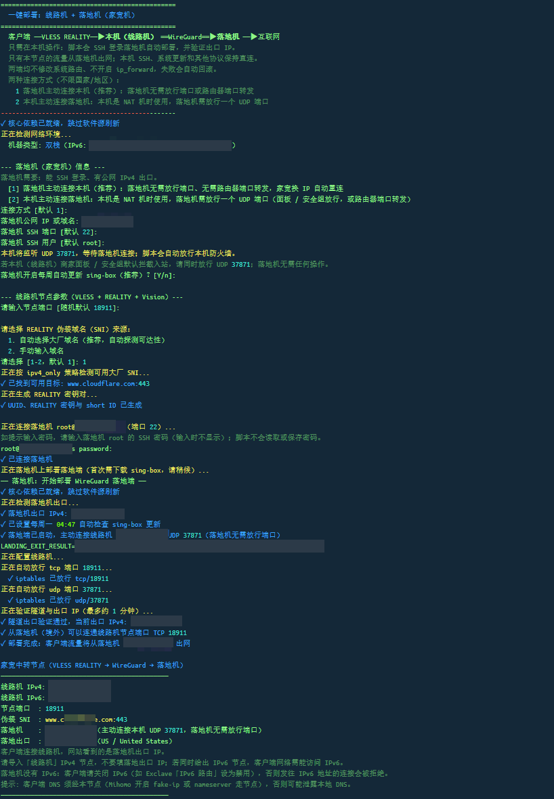
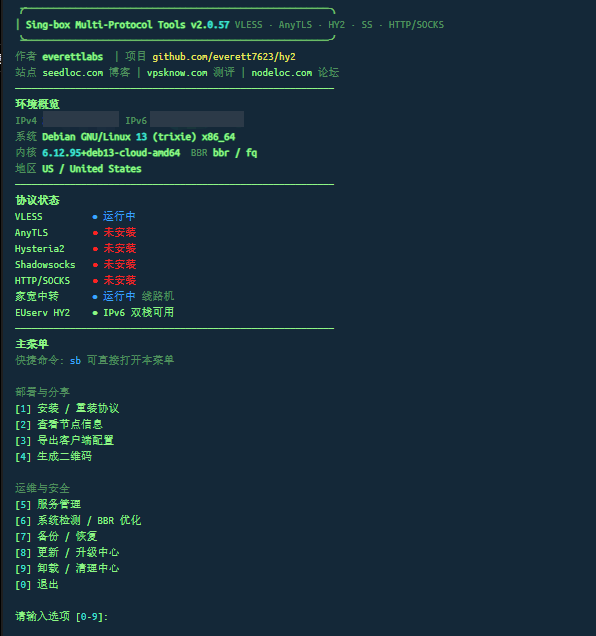
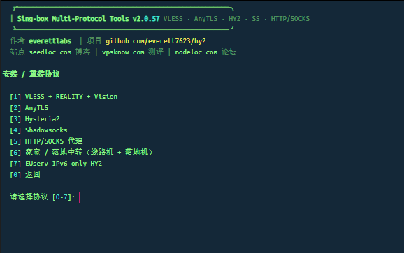
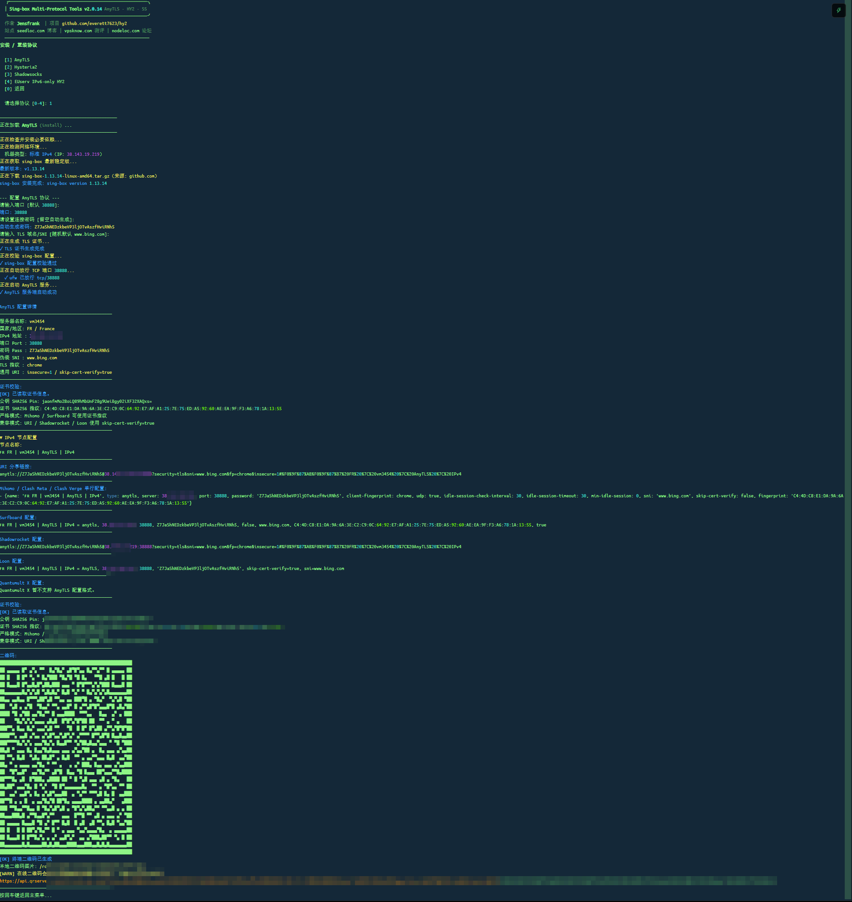
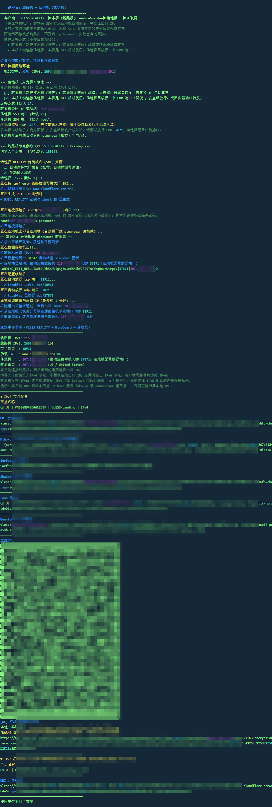
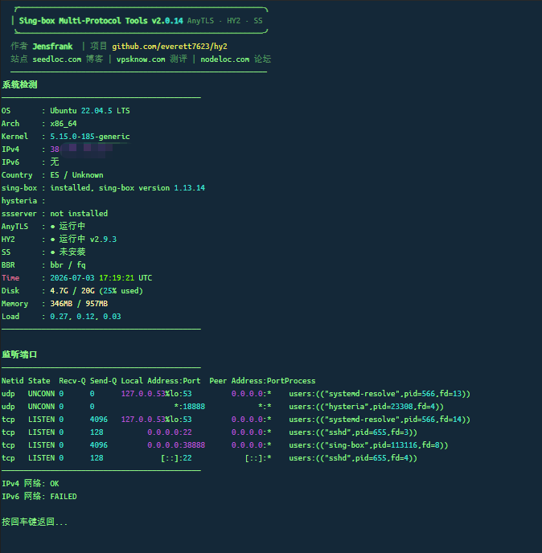
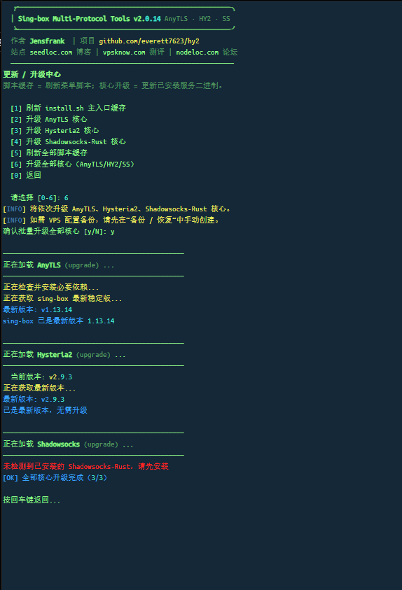
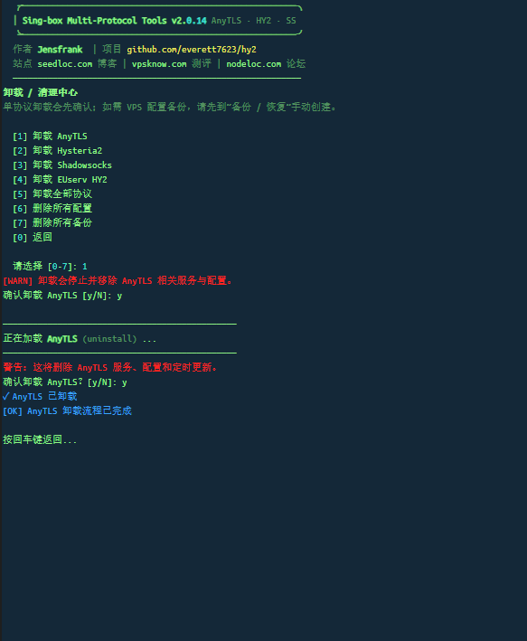

# Sing-box Multi-Protocol Tools

面向 Linux VPS 的多协议部署与管理脚本，统一管理 VLESS + REALITY + Vision、AnyTLS、Hysteria 2、Shadowsocks-Rust、HTTP/SOCKS（住宅 IP 独立协议）、家宽 / 落地中转（线路机 + 落地机）和 EUserv IPv6-only Hysteria 2。

[](https://github.com/everett7623/hy2/releases)
[](https://github.com/everett7623/hy2)
[](LICENSE)
[](https://github.com/everett7623/hy2/stargazers)
[](https://github.com/everett7623/hy2/commits/main)

> 当前版本：v2.0.69（2026-10-30） · 本次更新：AnyTLS 的 Surfboard / Loon 导出按官方文档修正格式，自签证书在两者中改用 64 位小写十六进制证书指纹严格校验；已部署节点重新查看节点信息后导入即可。

## 目录

- [核心能力](#核心能力)
- [快速开始](#快速开始)
- [协议选择](#协议选择)
- [家宽 / 落地中转](#家宽--落地中转)
- [客户端导出](#客户端导出)
- [系统与网络支持](#系统与网络支持)
- [管理与升级](#管理与升级)
- [常见问题](#常见问题)
- [开发与维护](#开发与维护)

## 核心能力

| 能力 | 说明 |
| --- | --- |
| 统一入口 | 一个 `install.sh` 管理多种协议方案，首次运行后可使用 `sb` 快捷命令 |
| 自动检测 | 识别发行版、CPU 架构、systemd/OpenRC、IPv4/IPv6、NAT 与防火墙环境；探测站不可达时按本机路由判定，不会把双栈机误判为纯 IPv6 |
| 安全部署 | 下载校验、临时文件、原子替换、配置备份、服务失败回滚 |
| 受限网络 | 公网 IP 探测跨多个 ASN 并含免 DNS 端点；版本获取支持 GitHub 镜像与 HTML 兜底；Hysteria 2 在 GitHub 全线不可达时改走官方永久镜像 |
| 节点导出 | 按协议输出 URI、Mihomo、Surfboard、Shadowrocket、Loon、Quantumult X 与二维码 |
| 服务管理 | 安装、重装、查看状态、启停、重启、日志、修改配置、升级和卸载 |
| 共享核心 | AnyTLS、VLESS、HTTP/SOCKS 与家宽中转安全共用 sing-box，升级前检查全部现存配置 |
| 家宽中转 | 节点协议可选 AnyTLS（默认）或 VLESS REALITY；线路机一键 SSH 部署落地机，用户态 WireGuard 隧道，自动验证出口 IP，失败两端回滚 |
| 系统工具 | 网络诊断、手动备份/恢复（恢复前校验归档、失败自动回滚），以及按需启用标准 `bbr + fq` |

## 快速开始

### 安装前确认

- 脚本需要 `root` 权限，会写入 `/etc`、systemd/OpenRC、防火墙、cron 和系统网络配置。
- 建议先在可销毁 VPS 上测试，并在云服务商控制台放行对应端口。
- 交互运行请使用 `bash <(curl ...)`，不要使用 `curl ... | sh`。
- VPS 需要能够访问 `raw.githubusercontent.com` 和 `api.github.com`。

如需先审阅入口脚本：

```bash
curl -fsSL https://raw.githubusercontent.com/everett7623/hy2/main/install.sh -o install.sh
less install.sh
bash install.sh
```

### 推荐安装命令

```bash
bash <(curl -fsSL https://raw.githubusercontent.com/everett7623/hy2/main/install.sh)
```

首次运行会安装统一快捷命令，之后直接执行：

```bash
sb
```

统一入口提供两组功能：

| 分组 | 功能 |
| --- | --- |
| 部署与分享 | 安装/重装、节点信息、客户端配置、二维码 |
| 运维与安全 | 服务管理、系统检测/BBR、备份/恢复、更新/升级、卸载/清理 |

<details>
<summary>独立运行协议脚本</summary>

```bash
# VLESS + REALITY + Vision
bash <(curl -fsSL https://raw.githubusercontent.com/everett7623/hy2/main/vless.sh)

# AnyTLS
bash <(curl -fsSL https://raw.githubusercontent.com/everett7623/hy2/main/anytls.sh)

# Hysteria 2
bash <(curl -fsSL https://raw.githubusercontent.com/everett7623/hy2/main/hy2.sh)

# Shadowsocks-Rust
bash <(curl -fsSL https://raw.githubusercontent.com/everett7623/hy2/main/ss.sh)

# HTTP/SOCKS Proxy (residential IP / mixed inbound)
bash <(curl -fsSL https://raw.githubusercontent.com/everett7623/hy2/main/proxy.sh)

# 家宽 / 落地中转（在线路机上运行）
bash <(curl -fsSL https://raw.githubusercontent.com/everett7623/hy2/main/landing.sh)

# EUserv IPv6-only Hysteria 2
bash <(curl -fsSL https://raw.githubusercontent.com/everett7623/hy2/main/euservhy2.sh)
```

</details>

## 协议选择

| 协议 | 适合场景 | 默认端口 | 关键说明 |
| --- | --- | --- | --- |
| VLESS REALITY | 需要 TCP、REALITY 与 XTLS Vision | 随机 `10000-65535/TCP` | 自动生成 UUID、REALITY 密钥与 short ID |
| AnyTLS | 需要轻量 TCP/TLS 传输 | 随机 `10000-65535/TCP` | 支持自签、已有域名证书和 sing-box 1.14+ ACME |
| Hysteria 2 | 大多数 IPv4/双栈 VPS，偏重 UDP 性能 | 随机 `10000-65535/UDP` | 支持单端口、端口跳跃和 NAT 外部端口 |
| Shadowsocks | 备用节点、IPv6/双栈环境 | 随机 `10000-65535/TCP+UDP` | 支持经典 AEAD 与 SS-2022；SS-2022 要求准确系统时间 |
| HTTP/SOCKS | 住宅 IP / 需要标准 HTTP 与 SOCKS5 同端口 | 随机 `10000-65535/TCP` | sing-box mixed 入站；出站可绑定原生网卡 |
| EUserv HY2 | EUserv IPv6-only VPS | 自定义 | 独立处理 NAT64 DNS、WARP 与纯 IPv6 下载回退 |

安装时生成的端口只是交互默认值，用户输入和 NAT 服务商的外部端口映射始终优先。

### VLESS REALITY 目标策略

安装时可选择两种 SNI 来源：

1. 随机大厂 SNI：从 Apple、Amazon、AMD、Mozilla、NVIDIA 和 Samsung 中随机选择首选目标，再从当前 VPS 并行验证 HTTPS/TLS 可达性。
2. 自定义 SNI：脚本提供域名输入和验证流程，也会输出 `bgp.tools` 查询入口作为可选筛选辅助。用户可输入任意候选域名，脚本验证域名格式、TLS 1.3 和当前 IPv4/IPv6 地址族可达性后才采用。

脚本不会自动抓取 `bgp.tools` 页面，也不会直接采用可能无效的机房默认 PTR。自定义域名不可达或不支持 TLS 1.3 时必须重新输入。

REALITY 目标只参与握手伪装，不承载客户端后续下载流量。用户可以在安装或配置修改时手动指定其他有效域名与端口。

## 家宽 / 落地中转

适合「线路好的 VPS 做入口，家宽 / 住宅 IP 机器做出口」的场景，例如流媒体解锁或需要住宅 IP 的网站。

```text
客户端 ──AnyTLS / VLESS REALITY──▶ 线路机 ══WireGuard（UDP）══▶ 落地机 / 家宽机 ──▶ 互联网
```

使用方法：在**线路机**上运行 `sb` → `[1] 安装 / 重装协议` → `[6] 家宽 / 落地中转` → `1. 一键部署`，选择节点协议（直接回车为 AnyTLS），按提示填写落地机 IP（或 DDNS 域名）、SSH 端口和用户，输入一次落地机 SSH 密码即可。脚本会：

1. 在线路机生成节点参数（AnyTLS：连接密码与自签证书；VLESS：UUID 与 REALITY 密钥）与 WireGuard 密钥；
2. 经 SSH 在落地机安装 sing-box 并启动 WireGuard 落地端（默认由落地机主动连接线路机，见下表）；
3. 启动线路机并经隧道实测出口 IP，确认是落地机 IP、且大请求也能通过后才完成部署，否则两端自动恢复原状；再由落地机（境外）实际连一次线路机的节点端口，商家面板 / 安全组没放行时直接提示；
4. 输出指向线路机的节点链接，节点名称按落地机出口 IP 的国家命名。双栈线路机只给 IPv4 节点出二维码，IPv6 节点仅作备用链接。

两种节点协议（客户端连线路机用哪种，与下面的连接方式互不影响，可任意搭配）：

| 选项 | 说明 |
| --- | --- |
| 1 AnyTLS（**推荐，默认**） | 自签证书，无需域名，自带流量填充。URI 带 `insecure=1`，Exclave、Shadowrocket 可直接导入；Mihomo / Surfboard / Loon 配置自带证书指纹，严格校验 |
| 2 VLESS + REALITY | 原有方案：借用大厂网站（Apple、Amazon 等）完成 TLS 握手，客户端无需信任证书 |

两种连接方式（同一套一键部署，按提示选择）：

| 选项 | 适用 | UDP 怎么通 |
| --- | --- | --- |
| 1 落地机主动连接本机（**推荐，默认**） | 任何落地机：云主机、解锁机、路由器后的真家宽 | 线路机监听一个 UDP 并自动放行本机防火墙；**落地机无需放行端口、无需端口转发**，家宽换 IP 后隧道自动恢复。线路机须有公网 IPv4（非 NAT 机），若线路机商家面板默认拦截入站，需放行该 UDP |
| 2 本机主动连接落地机 | 线路机是 NAT 机时使用 | 线路机拨号落地机；落地机需放行一个 UDP 端口：云主机在面板 / 安全组放行，路由器后的家宽做 UDP 端口转发，部署时填同一端口 |

示例（真家宽出口，不限国家）：你在任意国家 → 连 **线路机**（线路好的 VPS）→ 隧道到 **当地真·家宽落地机**。选 1 时家里路由器什么都不用设置，只要线路机能 SSH 登录落地机（SSH 端口需可达）。客户端永远只填线路机地址；网站看到的是落地机出口 IP。

### 实测可用的完整流程

实测环境：线路机为美国双栈 VPS（Debian 13），落地机为美国家宽 VM（只有 IPv4），客户端为 Android Exclave，节点协议为 VLESS + REALITY（v2.0.59）。AnyTLS 只换了客户端到线路机这一段，部署流程相同。

1. 在线路机运行 `sb` → `[1] 安装 / 重装协议` → `[6] 家宽 / 落地中转` → `1. 一键部署`。
2. 节点协议和连接方式都可以直接回车（`[1] AnyTLS`、`[1] 落地机主动连接本机`），依次填写落地机 IP、SSH 端口和用户（默认值直接回车），再输入一次落地机 SSH 密码。WireGuard 密钥由两端自动生成和交换，不需要手动处理任何密钥。
3. 部署结束前依次出现以下三行，就说明线路机到落地机这一段已经全部打通：
   - `✓ 隧道出口验证通过`：出口 IP 是落地机，域名解析与大包都正常；
   - `✓ 从落地机（境外）可以连通线路机节点端口 TCP xxxx`：商家面板 / 安全组已放行节点端口；
   - `✓ 部署完成`。
4. 客户端只导入**带二维码的 IPv4 节点**。IPv6 备用节点只在手机 / 电脑确定能访问线路机 IPv6 时使用。
5. **落地机没有 IPv6 时，客户端一般不用改设置**：v2.0.59 起，线路机会接管客户端经节点发出的明文 DNS 查询（TCP / UDP 53 端口，Exclave 默认的远程 DNS `tcp://1.1.1.1` 就属于这种），并去掉其中的 IPv6 地址，客户端自然只走 IPv4。只有客户端的远程 DNS 是加密 DNS（`https://`、`tls://` 开头），或者在本机直连解析时，线路机看不到这些查询，才需要在客户端关闭 IPv6：Exclave 把「IPv6 路由」设为「禁用」（已实测）；Mihomo / Clash 系配置 `ipv6: false`。

<details>
<summary>一键部署全过程截图（v2.0.58，VLESS；IP 已打码）</summary>



</details>

IPv6 问题的来龙去脉：客户端开着 IPv6 时，浏览器、YouTube 会直接用网站的 IPv6 地址发起连接。只有 IPv4 的落地机连不出去，网页就会一直加载失败；Telegram 直连 IPv4 地址，所以不受影响。客户端已经解析好的 IPv6 地址，线路机没办法改回域名，所以要从源头处理：经节点的 DNS 查询不返回 IPv6 地址，客户端也就不会去连 IPv6。落地机本身有 IPv6 时不做这层过滤。

其他注意：

- 落地机需要能 SSH 登录（root，或配置了免密 `sudo` 的用户）并能访问外网。
- 部署失败时会直接显示线路机日志里的 WireGuard 报错；也可在菜单「出口检测与诊断」中经 SSH 查看落地机状态。
- Telegram 能用、网页 / YouTube 打不开：实测中最常见的原因是客户端拿到了 IPv6 地址，而落地机只有 IPv4。这时线路机日志里会出现 `[240e:…]:443 … connection was refused` 这类 IPv6 地址被拒绝的报错。v2.0.59 起线路机会自动过滤经节点 DNS 查询返回的 IPv6 地址，已部署的节点在线路机执行「出口检测与诊断」或「升级 sing-box」即可生效；客户端用加密 DNS 时，仍需在客户端关闭 IPv6（见上）。其次才是隧道大包被丢（线路机与落地机之间路径 MTU 偏小）：v2.0.55 起隧道 MTU 为 1280，部署与诊断都会用大请求复测；v2.0.56 起两端隧道包不再带 DF，路径更小时分片送达。更早部署的节点在线路机执行「出口检测与诊断」或「升级 sing-box」即可自动修复，无需重新对接。
- 客户端节点超时、线路机日志里却一条连接都没有：说明连接根本没到线路机。常见原因是导入了 IPv6 节点、节点端口没放行，或者线路机 IP / 端口被墙。
- 只有本节点流量从落地机出网；VLESS 的 REALITY 握手从线路机直连伪装站，SSH 与系统更新也不走隧道。
- 换协议解决不了 IP 被封：线路机 IP 被封（所有端口都连不上）时两种协议都用不了，只能换 IP。AnyTLS 换掉的是 REALITY 的握手与流量特征，不保证不被封。
- AnyTLS 证书：自签证书放在线路机 `/etc/sing-box/landing-cert/`，有效期 10 年。选「保留现有节点参数」重新部署时沿用原证书，客户端里固定的证书指纹不变。节点信息页会显示证书 SHA256，Exclave 可在节点设置里手动填入以固定证书。
- 两端都不修改系统路由、不开启 `ip_forward`、不写 iptables NAT；落地机拒绝隧道访问其局域网与本机服务。
- 选 1（落地机主动连接）时家宽换 IP 无需任何操作；「更新落地机地址」只改 SSH 管理地址。选 2 时推荐给落地机配置 DDNS 域名：线路机每 2 分钟检查一次解析（需要 cron），变化后自动重启服务重连；若填固定 IP，换 IP 后在线路机菜单选择「更新落地机地址」。
- 客户端 DNS 需经节点解析（如 Mihomo 使用 fake-ip），否则网站可能看到本地 DNS。

## 客户端导出

| 客户端/平台 | Hysteria 2 | Shadowsocks | AnyTLS | VLESS REALITY | HTTP/SOCKS |
| --- | :---: | :---: | :---: | :---: | :---: |
| URI | ✅ | ✅ | ✅ | ✅ | HTTP + SOCKS5 |
| Mihomo / Clash Meta | ✅ | ✅ | ✅ | ✅ | — |
| Shadowrocket | ✅ | ✅ | ✅ | ✅ URI | URI |
| Loon | ✅ | ✅ | ✅ | ✅ | — |
| Surfboard | ✅ | ✅ | ✅ | 暂无已确认格式 | — |
| Quantumult X | 暂不推荐 | ✅ | 暂不推荐 | ✅ | — |
| 终端二维码 | ✅ | ✅ | ✅ | ✅ | SOCKS5 |
| v2rayN / NekoBox | ✅ | ✅ | 视客户端支持 | ✅ URI | URI |
| Stash | ✅ | ✅ | 视客户端支持 | 视客户端版本 | 视客户端支持 |

“✅”表示脚本提供对应格式或兼容 URI，不代表所有历史客户端版本均支持。升级客户端后仍无法导入时，优先使用 URI 或 Mihomo 配置，并核对协议、UUID/密码、SNI、公钥、short ID、端口和传输类型。

HTTP/SOCKS 仅导出 HTTP URI、SOCKS5 URI 与 SOCKS5 终端二维码，不提供 Mihomo 单行配置。

家宽 / 落地中转按所选节点协议导出：VLESS 同上表 VLESS REALITY 列；AnyTLS 提供 URI、Mihomo、Surfboard、Shadowrocket、Loon 与二维码。

当前保留的导出入口包括 URI、Mihomo/Clash、Surfboard、Shadowrocket、Loon、Quantumult X 和二维码；具体可用格式取决于协议。Throne 与 Sing-box/SFA 客户端 JSON 导出暂未提供。

## 系统与网络支持

| 系统 | 支持范围 |
| --- | --- |
| Debian | 10 / 11 / 12+ |
| Ubuntu | 20.04 / 22.04 / 24.04+ |
| CentOS / RHEL | 7 / 8 / 9 |
| Rocky / AlmaLinux | 8 / 9 |
| Fedora | 38+ |
| Arch / Manjaro | 滚动版本 |
| Alpine Linux | 3.x，使用 OpenRC |

支持标准 IPv4、双栈、IPv6-only 和 NAT VPS。常见上游架构包括 `amd64`、`arm64`、`armv7`、`386` 与 `s390x`；实际可用性取决于对应协议上游是否发布该架构的二进制文件。

## 管理与升级

### 常用动作

统一入口会向协议脚本传递 `install`、`info`、`manage`、`upgrade`、`uninstall` 等动作。VLESS 还提供只读诊断入口：

```bash
bash <(curl -fsSL https://raw.githubusercontent.com/everett7623/hy2/main/vless.sh) diagnose
```

### 重要边界

- 安装、升级和卸载不会自动创建 VPS 配置归档；如有需要，请先在“备份/恢复”中手动备份。
- BBR 默认只显示状态，不会随协议安装自动开启；启用标准 `bbr + fq` 属于用户主动操作。
- AnyTLS、VLESS、HTTP/SOCKS 与家宽中转共用 `/usr/local/bin/sing-box`，替换核心前会检查 `/etc/sing-box/*.json`，替换后重启所有正在运行的使用方。
- `sb` 优先获取 GitHub `main` 的最新入口，远端失败时才尝试使用本地缓存。
- 本地修改不会被远程 `install.sh` 使用；开发测试应直接运行本地子脚本。

## 常见问题

### 运行后无法输入

使用 `bash <(curl -fsSL URL)`。交互菜单依赖 `/dev/tty`，`curl URL | sh` 不能保证正确工作。

### GitHub 下载失败或仍显示旧版本

先检查网络、DNS 和系统时间：

```bash
curl -I https://raw.githubusercontent.com
curl -I https://api.github.com
date
```

刚发布后可临时绕过 GitHub raw 边缘缓存：

```bash
bash <(curl -fsSL -H 'Cache-Control: no-cache' "https://raw.githubusercontent.com/everett7623/hy2/main/install.sh?nocache=$(date +%s)")
```

### 机器类型被识别成「纯 IPv6」，但明明有公网 IPv4

v2.0.35 之前，IPv4 判定完全依赖 `api.ipify.org` 等外部探测站，探测失败即认定本机没有 IPv4；而 IPv6 判定已支持按本机地址与默认路由兜底。两侧标准不对称，双栈机会被判为纯 IPv6，节点只下发 IPv6 地址，IPv4 客户端全部连不上。

现在探测站全部不可达时会改用「原生网卡全局 IPv4 + 默认 IPv4 路由」确认，并在界面提示「已按本机默认路由确认 IPv4 可用」。探测站清单也已跨多个 ASN 并加入免 DNS 端点。

若仍被误判，请先确认本机确有默认 IPv4 路由和全局地址，再排查探测站可达性：

```bash
ip -4 route show default
ip -4 addr show scope global
curl -s4 --connect-timeout 5 https://1.1.1.1/cdn-cgi/trace | grep ^ip=
```

注意：WARP 与隧道网卡持有的 IPv4 不参与判定；网卡只有私网地址时会按 NAT 处理，需手动指定节点地址。

### 服务已安装但客户端无法连接

按以下顺序检查：

1. 脚本菜单中的服务状态、日志和监听端口。
2. 云安全组以及 VPS 本机防火墙是否放行正确的 TCP/UDP 端口。
3. NAT 外部端口是否映射到脚本监听端口。
4. 节点地址是否误用了 WARP 出口或不可达 IPv6。
5. SS-2022 客户端与服务端时间是否准确。
6. VLESS 的 UUID、SNI、REALITY 公钥、short ID 和 `xtls-rprx-vision` 是否一致。
7. REALITY 目标是否能从 VPS 正常访问。

### VLESS 能连接但速度慢

VLESS 诊断会检查 REALITY 目标、Cloudflare 下载探针和当前 TCP 拥塞控制。下载探针只是 VPS 当次网络状态的参考，不等价于客户端经代理的端到端测速。

- REALITY 目标失败：修改配置，选择当前 VPS 可达的目标。
- VPS 下载探针也慢：检查 VPS 带宽、负载、线路和服务商限速。
- VPS 下载探针正常但客户端慢：继续检查客户端分流、MTU、运营商路由和云安全组。
- 只有 Speedtest 失败：测速站可能限制数据中心 IP 或代理流量，请用普通 HTTPS 下载交叉验证。

<details>
<summary>运行截图</summary>

### 首页总览



### 安装 / 重装协议



### AnyTLS 安装与节点导出



### 家宽 / 落地中转



### 系统检测



### 更新/升级中心



### 卸载/清理中心



</details>

## 开发与维护

| 文件 | 用途 |
| --- | --- |
| `install.sh` | 统一入口、菜单、缓存和跨协议调度 |
| `hy2.sh` / `ss.sh` | Hysteria 2 与 Shadowsocks-Rust 管理 |
| `anytls.sh` / `vless.sh` | sing-box 原生 AnyTLS 与 VLESS 管理 |
| `proxy.sh` | sing-box 原生 mixed（HTTP + SOCKS5）管理 |
| `landing.sh` | 家宽 / 落地中转：线路机 AnyTLS 或 VLESS REALITY + 用户态 WireGuard 落地 |
| `euservhy2.sh` | EUserv IPv6-only 独立脚本 |
| `tests/validate_scripts.sh` | Bash 语法、版本、换行和行为验证总入口 |
| `docs/` | 架构、测试、发布和维护边界 |

开发前请阅读：

- [贡献指南](CONTRIBUTING.md)
- [架构说明](docs/ARCHITECTURE.md)
- [测试指南](docs/TESTING.md)
- [发布流程](docs/RELEASE.md)
- [维护与安全边界](docs/MAINTENANCE.md)
- [变更日志](CHANGELOG.md)

本地修改后运行：

```bash
bash tests/validate_scripts.sh
git diff --check
```

运行时安装、升级、防火墙和卸载仍需在一次性 VPS 上验证。项目要求每次提交一组修改时同步提升统一版本、日期、README、测试期望和 CHANGELOG。

## 项目信息

| 项目 | 地址 |
| --- | --- |
| Author | everettlabs |
| GitHub | [everett7623/hy2](https://github.com/everett7623/hy2) |
| Blog | [seedloc.com](https://seedloc.com) |
| Review | [vpsknow.com](https://vpsknow.com) |
| Forum | [nodeloc.com](https://nodeloc.com) |
| License | [MIT](LICENSE) |

## 免责声明

- 本项目仅供学习、技术研究和网络协议交流使用。
- 请遵守所在地法律法规和云服务商使用条款。
- 使用本项目产生的风险和后果由使用者自行承担。

如果项目对你有帮助，欢迎 Star 支持。
